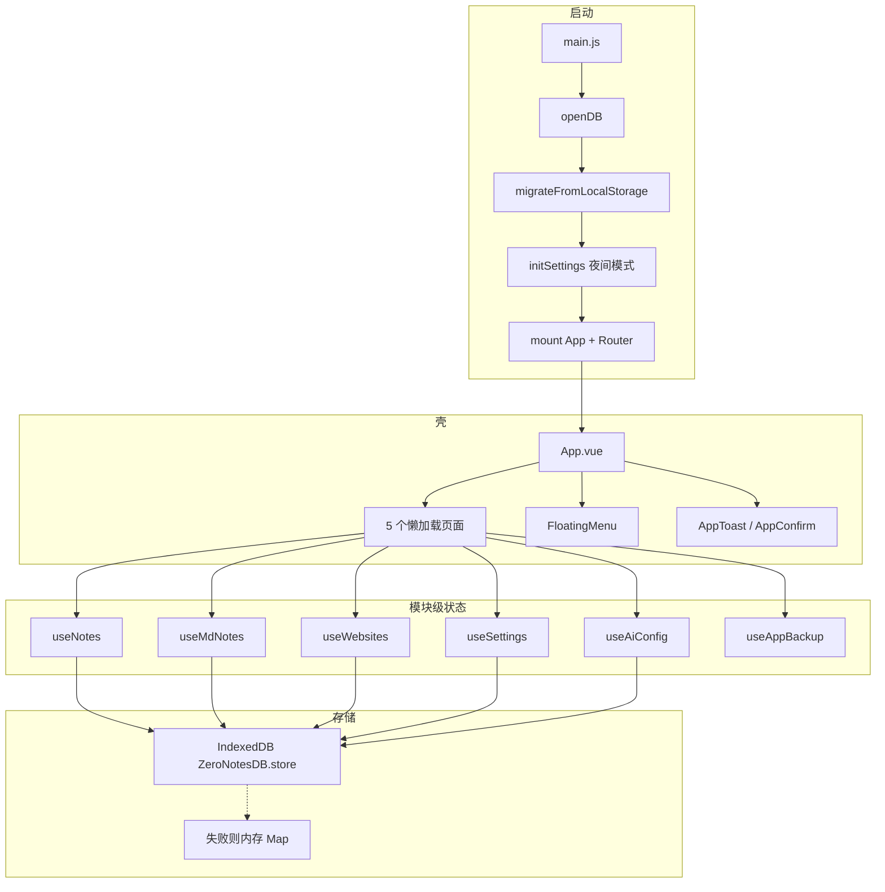
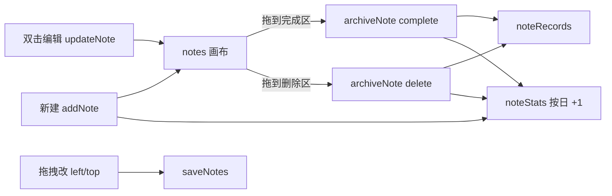
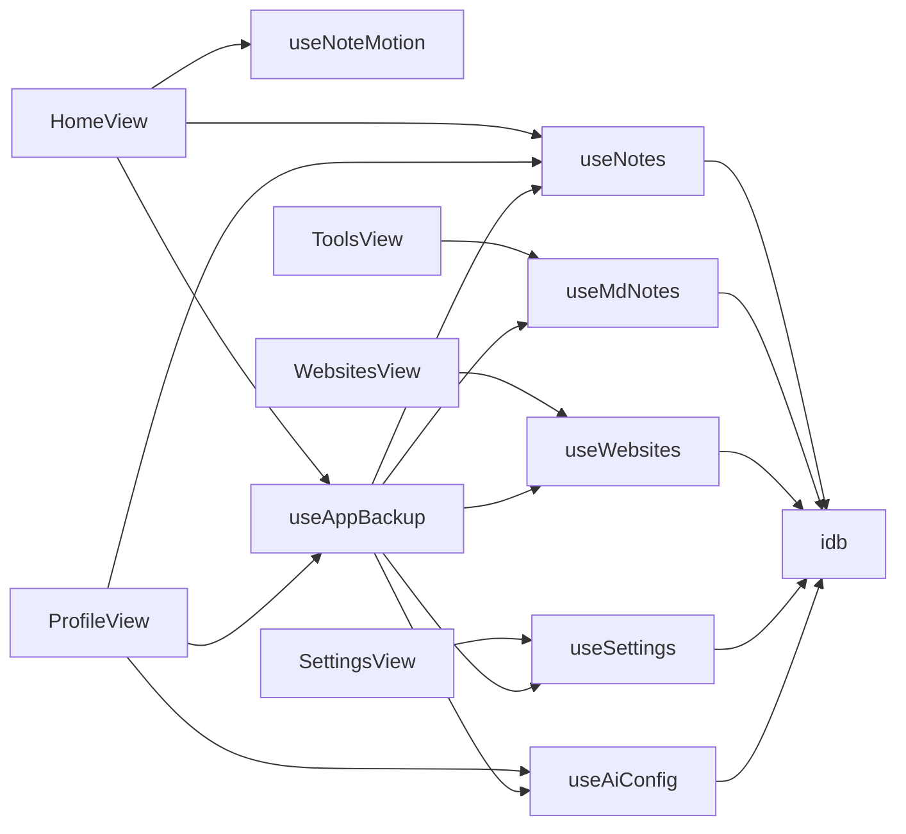

# 零点笔记：当前实现逻辑

纯前端、本地优先的 Vue 3 SPA：无后端、无 Pinia。各业务 composable 用 **模块级 `ref` 单例** 共享状态；[`src/utils/idb.js`](src/utils/idb.js) 把 IndexedDB 封装成 `idbGet` / `idbSet` 键值 API。

## 一句话架构

**Vue 3 + Vue Router 4 + Vite 6**，数据全部在浏览器。

## 启动与壳层

[`src/main.js`](src/main.js) 异步启动，顺序固定：

1. `openDB()` — 打开库 `ZeroNotesDB` v1，对象仓库名 `store`
2. `migrateFromLocalStorage()` — 若未写过 `__migrated_from_ls__`，把旧版 `localStorage` 的 `notes / noteRecords / noteStats / websites / websiteGroups / md_notes` 迁入 IDB（只迁一次）
3. `initSettings()` — 读 `appSettings`，给 `html` 打 `night-mode`
4. 挂载 Vue + Router
5. 若已降级内存模式，toast 提示「仅保存在本次会话」

[`src/App.vue`](src/App.vue)：路由 `out-in` 过渡 + 全屏 loading；全局叠加 [`FloatingMenu`](src/components/FloatingMenu.vue)、[`AppToast`](src/components/AppToast.vue)、[`AppConfirm`](src/components/AppConfirm.vue)。

路由在 [`src/router/index.js`](src/router/index.js)：History 模式，5 个懒加载页，未知路径回首页。

| 路径 | 页面 |
| --- | --- |
| `/` | 首页便签 |
| `/tools` | 工具箱 |
| `/profile` | 个人中心 / 周报 |
| `/websites` | 常用网站 |
| `/settings` | 系统设置 |

## 存储层

[`src/utils/idb.js`](src/utils/idb.js)：

- **一个 object store、key 当表名**：不是按实体建 store，而是 `put(value, key)`
- 写入前 `JSON.parse(JSON.stringify)`，保证可结构化克隆
- IndexedDB 不可用或 `put` 失败 → 切 `memoryMode`，改写内存 `Map`（刷新丢失）
- `onversionchange` / `onclose` 会把连接置空，下次 `ensureDB()` 再开

当前键：

| 键 | 内容 | 写入方 |
| --- | --- | --- |
| `notes` | 活跃便签数组 | `useNotes` |
| `noteRecords` | 完成/删除归档 | `useNotes` |
| `noteStats` | `{ YYYY-MM-DD: { created, completed, deleted } }` | `useNotes` |
| `md_notes` | Markdown 笔记 | `useMdNotes` |
| `websites` / `websiteGroups` | 书签与分组 | `useWebsites` |
| `appSettings` | 夜间模式等 | `useSettings` |
| `aiConfig` | API 地址 / Key / 模型 / 提示词 | `useAiConfig` |
| `__migrated_from_ls__` | 迁移标记 | `idb.js` |

所有 composable 都是 **模块级 `ref` + `initialized` 门闩**：多次 `useXxx()` 共享同一份内存；`initXxx()` 只从 IDB 读一次。导入备份走内存替换（`replaceAllNoteData` / `saveXxx`），不依赖再 `init`。

## 首页便签

入口：[`src/views/HomeView.vue`](src/views/HomeView.vue) + [`useNotes`](src/composables/useNotes.js) + [`useNoteMotion`](src/composables/useNoteMotion.js)。

**便签模型**：`{ id, content, color, priority, left, top, createdAt, updatedAt }`。内容最多 200 字；颜色 `color1–8`；优先级 `normal / important / urgent`。新建时随机落在视口内。

**生命周期**：

- 拖到完成/删除区：先 `flyToAction` 动画，再 `archiveNote`：从 `notes` 移除，头部插入 `noteRecords`（带 `action`、`actionTime`），并 `bumpStat`
- 归档记录不再出现在首页；统计与记录在个人中心消费
- **整理便签**：按优先级分三列，叠放（可见高度 40px），写回坐标
- **空闲 10s**（无鼠标/键盘）：便签在区域内弹跳；拖拽/进入画布会停。停下来时 `persist` 写盘
- **随机动画**：给便签加 CSS keyframe（不改坐标）

导入导出走全量备份 [`useAppBackup`](src/composables/useAppBackup.js)（见下文）。

## 工具箱

[`src/views/ToolsView.vue`](src/views/ToolsView.vue) 是 **页内多标签**（只存在内存，关页即丢，Markdown 笔记除外）。

| 工具 | 组件 | 是否持久化 |
| --- | --- | --- |
| Markdown 笔记 | [`MarkdownNotePanel`](src/components/tools/MarkdownNotePanel.vue) | `Ctrl/Cmd+S` → `upsertMdNote` → `md_notes` |
| Markdown 编辑器 | [`MarkdownEditorPanel`](src/components/tools/MarkdownEditorPanel.vue) | 否，临时 |
| JSON 格式化 | [`JsonFormatterPanel`](src/components/tools/JsonFormatterPanel.vue) | 否；输入 400ms 防抖自动格式化 |
| 我的笔记 | [`NoteListPanel`](src/components/tools/NoteListPanel.vue) | 列表读 `mdNotes`；点卡片会开已有笔记标签 |

左右分栏由 [`SplitEditor`](src/components/SplitEditor.vue) 拖拽 gutter。Markdown 预览：`marked` + `DOMPurify`（[`src/utils/markdown.js`](src/utils/markdown.js)）。未保存的笔记标签关页会 `confirmAction`；浏览器刷新走 `beforeunload`。

笔记模型：`{ id, title, content, createdAt, updatedAt }`。

## 个人中心

[`src/views/ProfileView.vue`](src/views/ProfileView.vue) 只读/消费便签侧数据：

- **三张累计卡 + Chart.js 柱状图**：对 `noteStats` 按日期求和/绘图
- **操作记录**：`noteRecords` 按关键词、创建日、操作日过滤，每页 20 条；可批量 `deleteRecords`（只删记录，不回滚统计）
- **本地周报**：选 ISO 周 → 该周「完成记录 + 当周创建（活跃∪归档）+ 当前活跃便签」拼纯文本
- **AI 周报**：浏览器 `fetch` `{apiUrl}/chat/completions`（OpenAI 兼容），system = 提示词，user = 完成项 + 活跃便签；返回 Markdown 经 `renderMarkdown` 展示。Key 存在本地 `aiConfig`，**备份 JSON 会带上 Key**
- 导入导出同样走全量 `useAppBackup`

离开页会 `abort` 进行中的 AI 请求。

## 常用网站

[`src/views/WebsitesView.vue`](src/views/WebsitesView.vue) + [`useWebsites`](src/composables/useWebsites.js)：

- 首次无数据时写入 [`DEFAULT_WEBSITES` / `DEFAULT_WEBSITE_GROUPS`](src/constants/websites.js)
- 分组 Tab + 标题/URL/描述搜索；打开链接只允许 `http/https`（`ensureHttpUrl` + `noopener`）
- 删分组：组内书签 `group` 置空，变为未分组
- **本页导入导出只含书签**（`网站书签_日期.json`），与首页/个人中心的全量备份不同

## 设置与反馈

[`useSettings`](src/composables/useSettings.js)：`nightMode` 会切 `html.night-mode`（CSS 变量在 [`global.css`](src/styles/global.css)）。`notifications`、`autoUpdate` **只存开关，没有业务逻辑**。

[`useFeedback`](src/composables/useFeedback.js)：全局 toast 队列（2.8s）+ 单槽 `confirmAction` Promise（新确认会把旧的 resolve 成 false）。

## 全量备份

[`useAppBackup.js`](src/composables/useAppBackup.js) `BACKUP_VERSION = 2`：

导出字段：`notes, noteRecords, noteStats, websites, websiteGroups, mdNotes, appSettings, aiConfig`。

导入：确认后覆盖对应模块；兼容旧字段 `md_notes`；文件上限 10MB。判定「全量备份」较宽：有 `notes` 数组、或 `noteRecords` 数组、或有 `version` 即可。

## 模块依赖关系

## 实现上值得知道的点

- **没有 Vuex/Pinia**：跨页状态全靠 composable 模块单例，刷新后靠 IDB + 各页 `onMounted` 的 `initXxx`
- **统计与记录可分叉**：批量删记录不减 `noteStats`；导入可覆盖统计
- **工具箱 Tab 不落盘**；只有 Markdown 笔记 `Ctrl+S` 才进 `md_notes`
- **设置页两个开关是占位**；夜间模式是唯一生效项
- **无后端、无鉴权**；AI Key 和备份文件都在本机，换设备只能靠 JSON 备份
